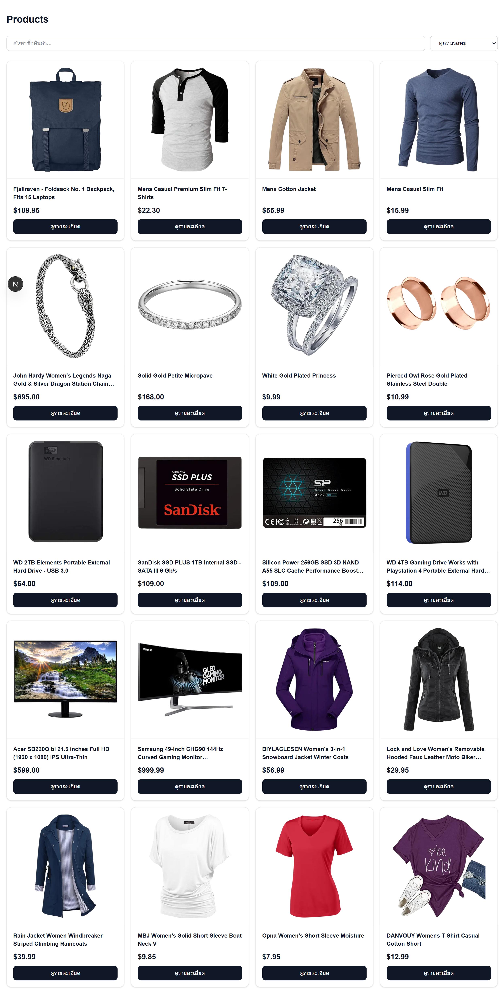
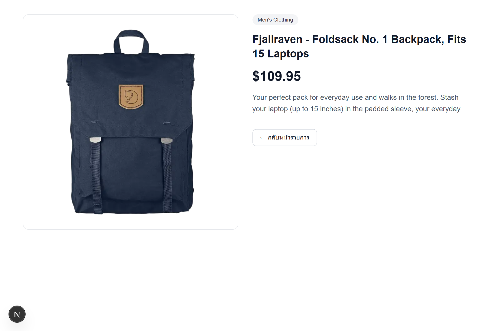
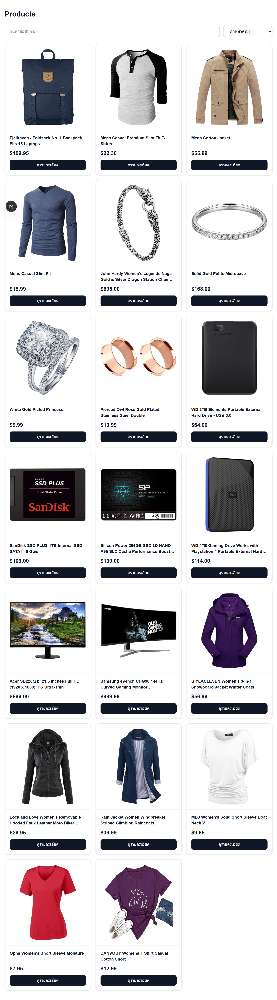
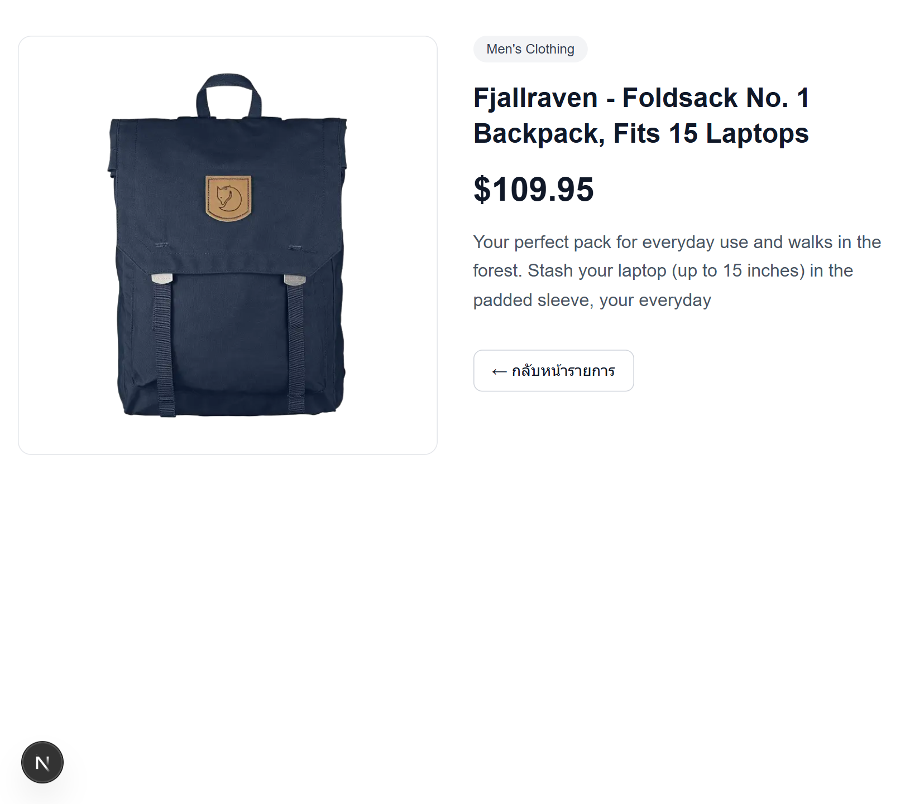
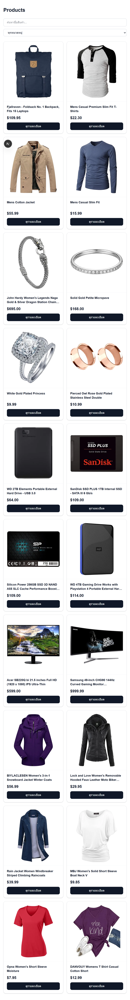
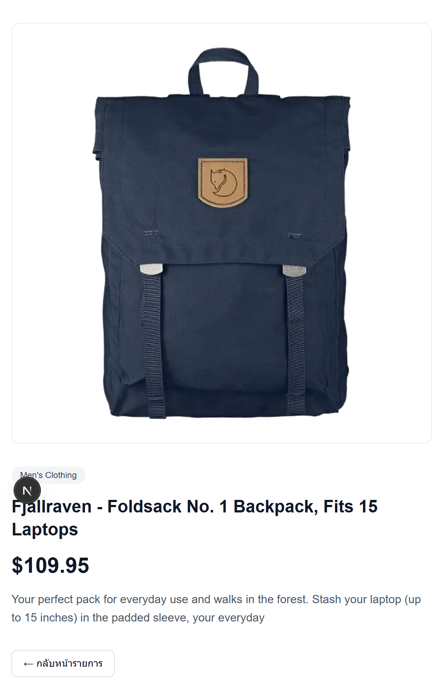

# Product Store

Trainee Assignment #1: Product Listing + Detail Page (Next.js)

เว็บแสดงสินค้า 2 หน้า ดึงข้อมูลจาก [Fake Store API](https://fakestoreapi.com) ด้วย Axios

## Features

- **Product List:** แสดงสินค้าเป็น grid (รูป, ชื่อ, ราคา) พร้อมปุ่มไปหน้ารายละเอียด
- **Product Detail:** แสดงรูป, ชื่อ, ราคา, หมวดหมู่ และรายละเอียดสินค้า
- **Responsive:** grid 2 / 3 / 4 คอลัมน์ ตามขนาดหน้าจอ (mobile / tablet / desktop)
- **Loading state:** Skeleton UI ทั้งหน้า List และ Detail
- **Error state:** แสดงข้อความและมีปุ่ม "ลองใหม่"
- **Search และ Filter:** ค้นหาตามชื่อสินค้า และกรองตามหมวดหมู่
- **Not found:** แสดงข้อความ "ไม่พบสินค้า" เมื่อ id ไม่ถูกต้อง

## Tech Stack

- Next.js (App Router)
- TypeScript
- Axios
- Tailwind CSS

## API

| Method | Endpoint | ใช้ทำอะไร |
|---|---|---|
| GET | `https://fakestoreapi.com/products` | ดึงรายการสินค้าทั้งหมด |
| GET | `https://fakestoreapi.com/products/{id}` | ดึงสินค้าตาม id |

## Getting Started

ต้องมี Node.js 20 ขึ้นไป

```bash
npm install
npm run dev
```

เปิด [http://localhost:3000](http://localhost:3000) (หน้าแรกจะ redirect ไป `/products`)

คำสั่งอื่น

```bash
npm run lint    # ตรวจโค้ดด้วย ESLint
npm run build   # build สำหรับ production
npm run start   # รันผล build
```

## Project Structure

```
src/
 ┣ app/
 │ ┣ page.tsx                 redirect ไป /products
 │ ┣ products/page.tsx        หน้า Product List
 │ ┗ products/[id]/page.tsx   หน้า Product Detail
 ┣ components/
 │ ┣ ProductCard.tsx
 │ ┣ ProductDetail.tsx
 │ ┣ ProductFilters.tsx
 │ ┣ ProductSkeleton.tsx
 │ ┣ ProductDetailSkeleton.tsx
 │ ┗ ErrorMessage.tsx
 ┣ lib/api.ts                 Axios instance
 ┣ services/products.ts       ฟังก์ชันเรียก API
 ┗ types/product.ts           TypeScript types
```

## Implementation Notes

- Tailwind CSS is processed by PostCSS through `postcss.config.mjs` and scans `src/` for utility classes.
- The root URL redirects to `/products` through the Next.js redirects configuration.
- ดึงข้อมูลด้วย `useEffect` + `useState` ใน Client Component และใช้ `AbortController` ยกเลิก request ตอน component ถูกถอดหรือเมื่อ id เปลี่ยน
- หน้า List ดึงสินค้าครั้งเดียว แล้วกรองด้วย Search และ Filter ใน browser
- หน้า Detail อ่าน `id` ด้วย `useParams()` ซึ่งต้องครอบด้วย `<Suspense>` เพราะ Next.js 16 เปิด Cache Components
- รูปสินค้าโหลดผ่าน `next/image` จึงตั้ง `images.remotePatterns` สำหรับ `fakestoreapi.com` ใน `next.config.ts`

## Screenshots

| Product List | Product Detail |
|---|---|
|  |  |

| Product List (tablet) | Product Detail (tablet) |
|---|---|
|  |  |

| Product List (mobile) | Product Detail (mobile) |
|---|---|
|  |  |